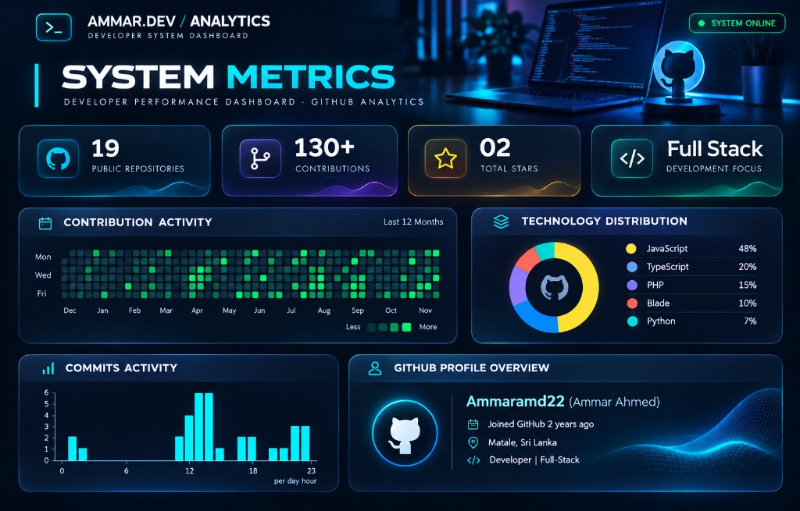

<div align="center">


<br />

[](https://github.com/Ammaramd22)
[](https://linkedin.com/in/ammarahmed22)


</div>

---

<div align="center">


</div>

I am a **Full-Stack Developer** focused on designing and delivering enterprise-grade web applications that solve real business problems.

I work across the full stack — building responsive UI/UX, developing APIs and backend services, and designing database architectures that support scalable, production-ready systems.

I hold a Computer Science degree from the **University of Bedfordshire**, and apply that foundation to real-world software used in POS, inventory, fleet, hospitality, and e-commerce environments.

```text
🚀  Scalable full-stack web applications
🏢  Enterprise and business management systems
🧾  POS · Inventory · Fleet · Hospitality platforms
🛒  E-commerce applications
⚙️  Modern frontend and backend engineering
```


---

<div align="center">


</div>

| | Area | Focus |
| :---: | :--- | :--- |
| 01 | **Enterprise Applications** | Business-oriented platforms for operations and management |
| 02 | **Full-Stack Development** | End-to-end delivery across frontend, backend, and data layers |
| 03 | **React & Next.js** | Modern, performant user interfaces and web applications |
| 04 | **REST APIs** | Reliable API design and integration |
| 05 | **Database Architecture** | Structured data modeling and system integration |
| 06 | **POS & ERP Solutions** | Billing, inventory, and operational workflows |
| 07 | **Cloud Applications** | Cloud-backed application development and deployment |
| 08 | **AI Integration** | Practical AI features within business applications |


---

<div align="center">


</div>

### Frontend

<p align="center">
  
</p>

<p align="center">
  
  
  
  
  
</p>

### Backend

<p align="center">
  
</p>

<p align="center">
  
  
  
  
</p>

### Database

<p align="center">
  
</p>

### Languages & Tools

<p align="center">
  
</p>


---

<div align="center">


</div>

### QPOS — Restaurant POS & Management System

A comprehensive restaurant and bakery management platform covering billing, kitchen operations, inventory, and multi-branch workflows.

**Highlights**
- POS Billing · Inventory Management · Kitchen Display System (KDS)
- Kitchen Order Tickets (KOT) · Waiter Management · QR Table Ordering
- Purchasing & Suppliers · Recipe Management · Finance & Reports · Multi-Branch

[](https://github.com/Ammaramd22/mtc-qpos)

---

### QHotelPro — Hospitality Management System

A comprehensive hospitality management platform for booking, front desk, guest services, and operational oversight.

**Highlights**
- Booking & Reservations · Accommodation · Front Desk · Guest Management
- Purchasing & Suppliers · Financial Management · Staff Management
- Fleet Management · Reporting & Analytics

---

### Fleet Operations Management Platform

An enterprise fleet management application for vehicles, rentals, maintenance, and operational control — built with React, Vite, Tailwind CSS, and Supabase.

**Highlights**
- Vehicle · Rental · Customer · Maintenance · Incident · Tow Services
- Fleet Expenses · Finance & Reports · Role-Based Access Control

[](https://github.com/Ammaramd22/Fleet-Management_V1)

---

### Jewellery E-Commerce Platform

A modern jewellery e-commerce application with catalog browsing, shopping flows, and admin operations.

**Highlights**
- Product Catalog · Categories · Cart · Wishlist · Authentication
- Admin Dashboard · Order Management · Supabase Integration

---

### AutoLedger — Vehicle Dealer Management

A business management application for vehicle dealers, supporting accounting workflows, vehicle management, and day-to-day dealer operations.

---

### Accountant Firm Management System

A business management platform for accounting firms, focused on client management, document handling, and administrative operations.


---

<div align="center">


<br />



<br />


<br /><br />


<br /><br />


<br />


</div>


---

<div align="center">


</div>

- Advanced System Architecture
- Scalable Backend Development
- AI-Powered Applications
- Cloud Infrastructure and Deployment
- Performance Optimization
- Modern Web Application Technologies


---

<div align="center">


[](https://github.com/Ammaramd22)
[](https://linkedin.com/in/ammarahmed22)

<br />


</div>
